# vibe-coding
個人運動日誌 exercise log

## 網頁內容截圖
說明: 第一次點進網頁會跳出視窗，使用者可輸入名字。
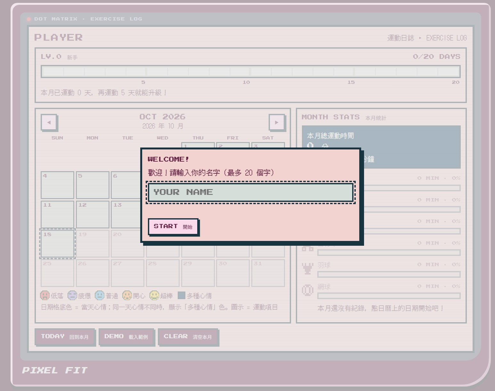

說明: 網頁主要畫面
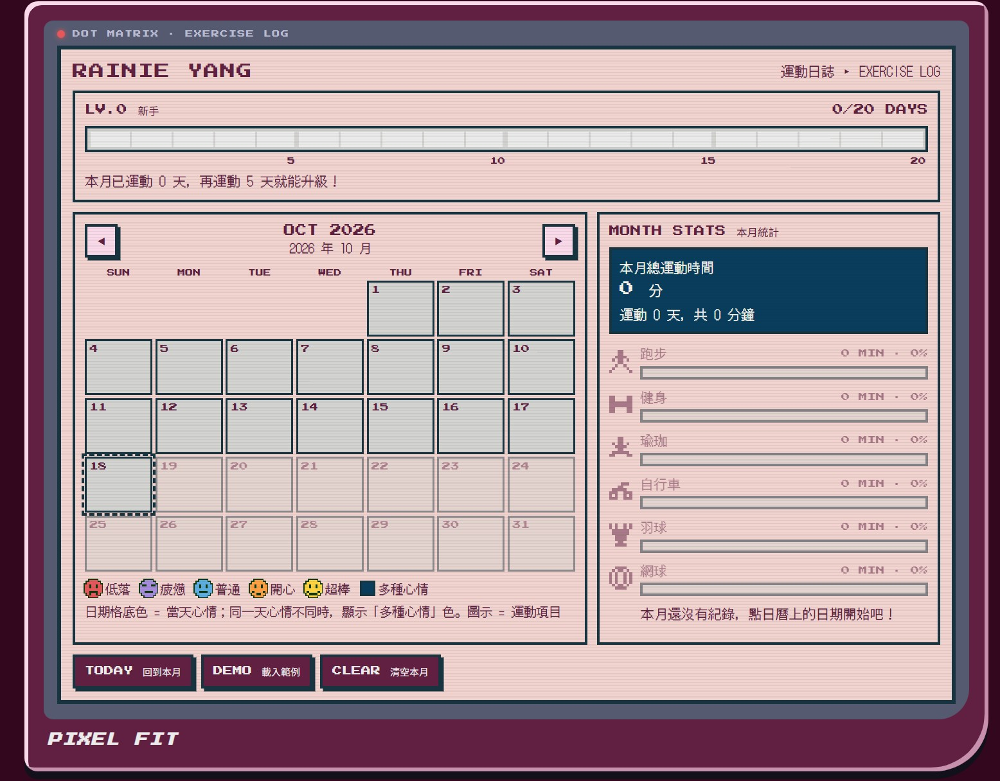

說明: 點選日曆中的某格(某一天)，紀錄運動項目、時間、心情、心情留言。
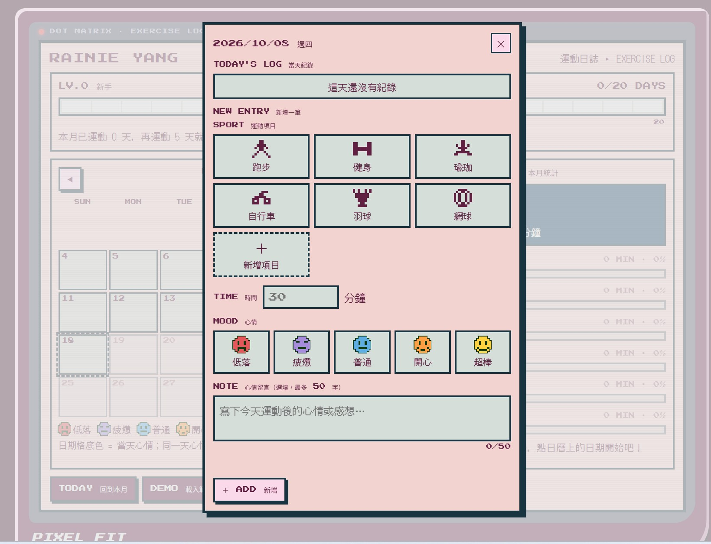
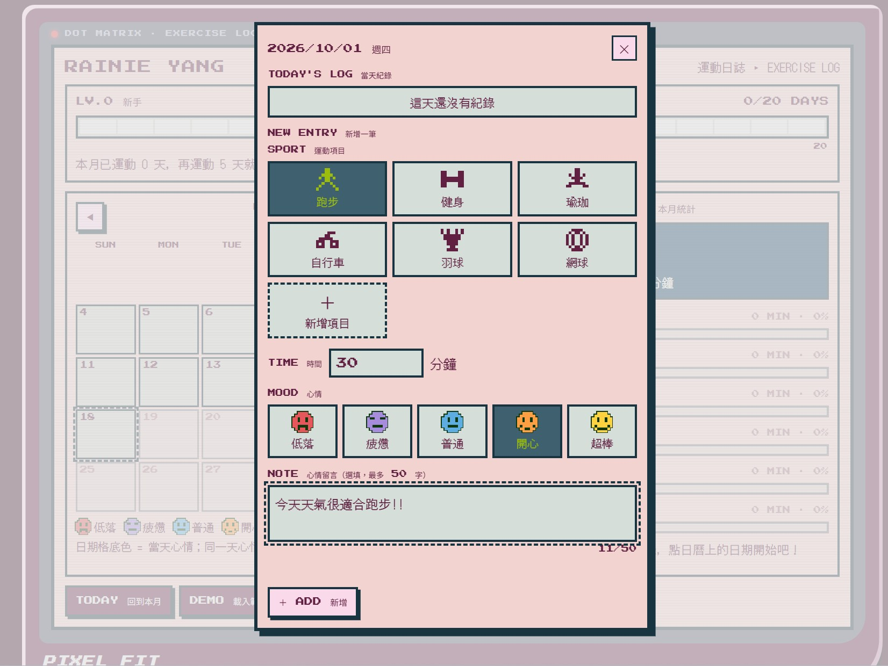

說明: 日曆格子會顯示有紀錄的運動項目圖示與心情代表顏色。
右邊的統計資訊，統計當月總運動時間、天數及各運動項目的總時間與佔比。
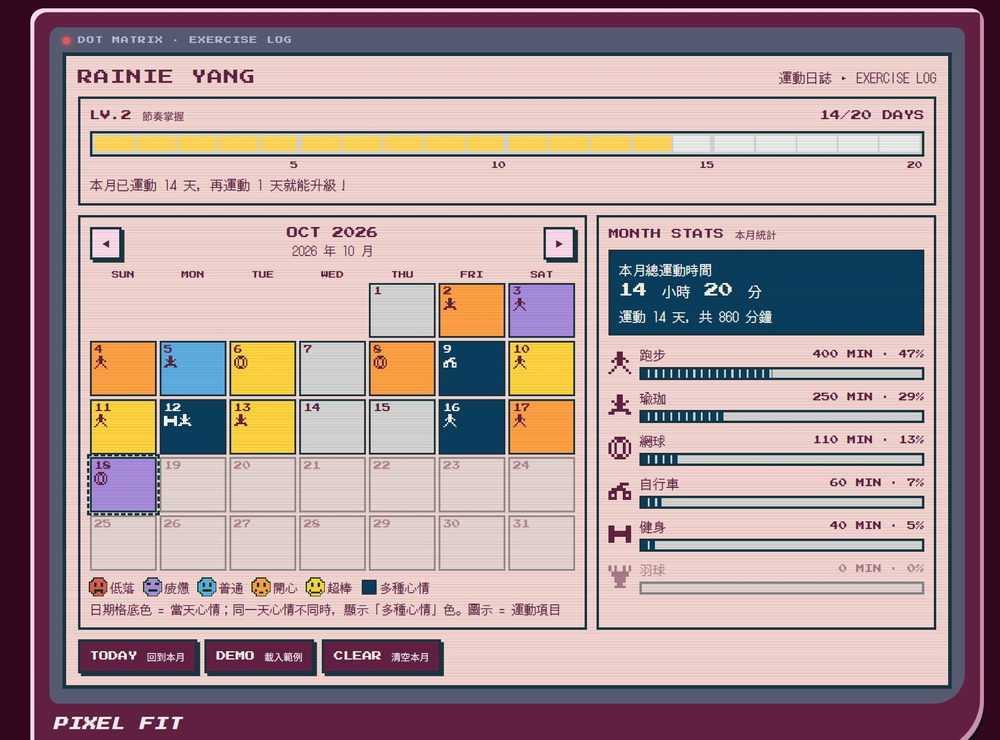

說明: 可點選某天查看運動紀錄，且可進行編輯與刪除。
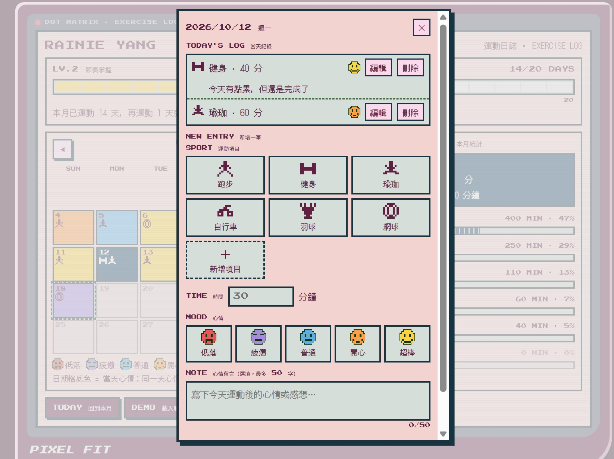

說明: 使用者可自行新增預設6種運動項目以外的運動，也可自行刪除。
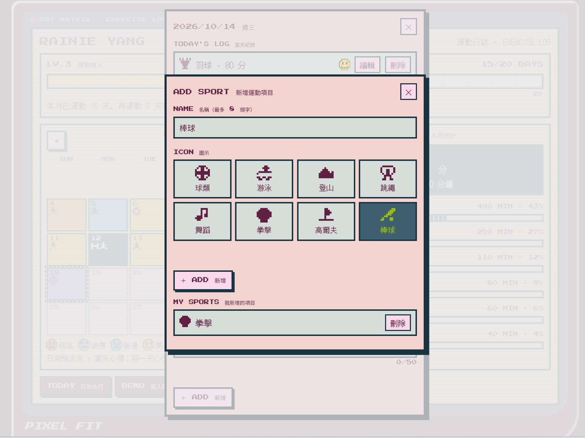

說明: 每運動滿5天升一級(5、10、15、20天)。新增紀錄使等級提高時，顯示升級訊息: 跳出像素小人、以打字機效果顯示鼓勵訊息，並播放升級音效(等級越高，黃色星星數越多)。
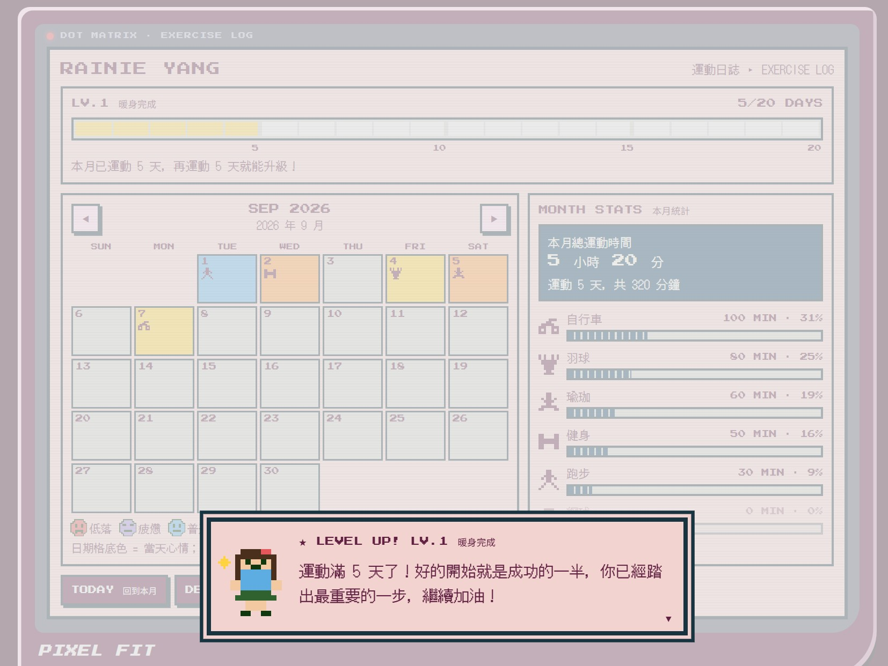
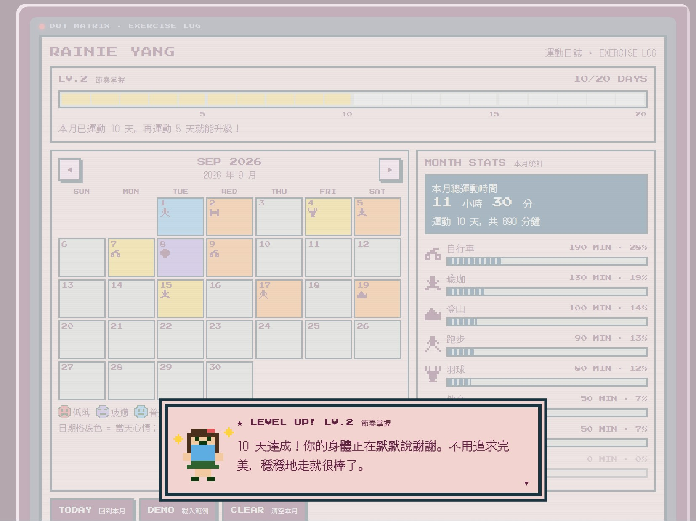
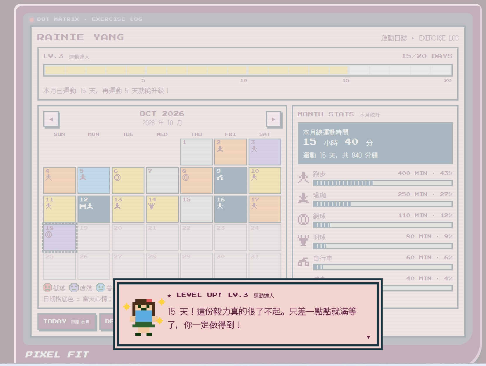
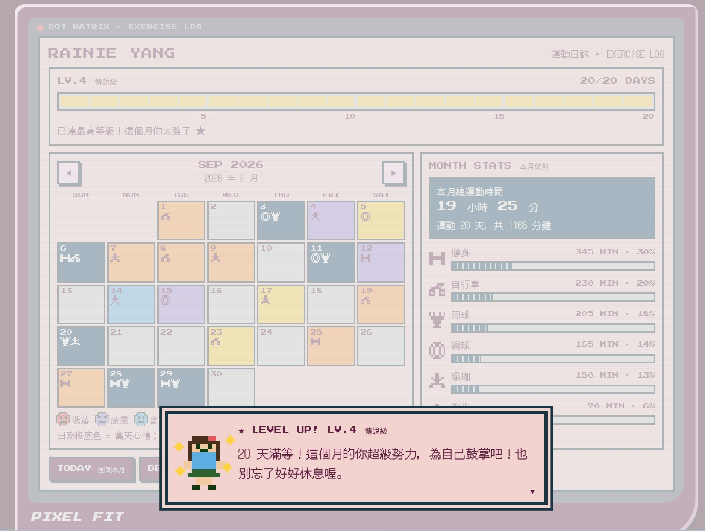

說明: 可透過 ◀ ▶或鍵盤左右鍵切換月份 
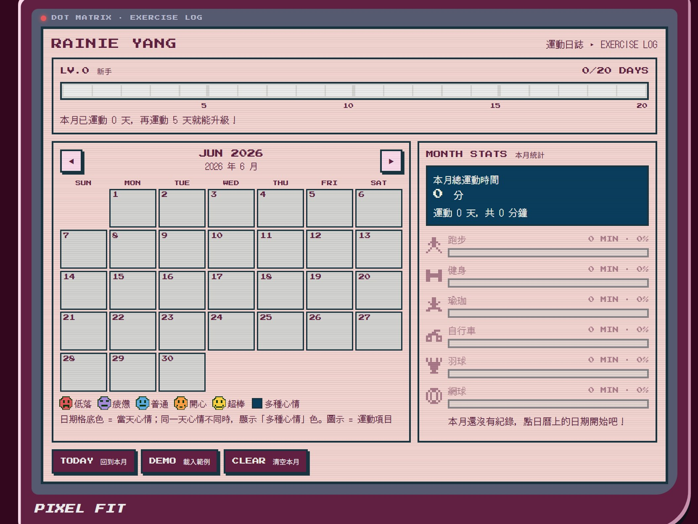
